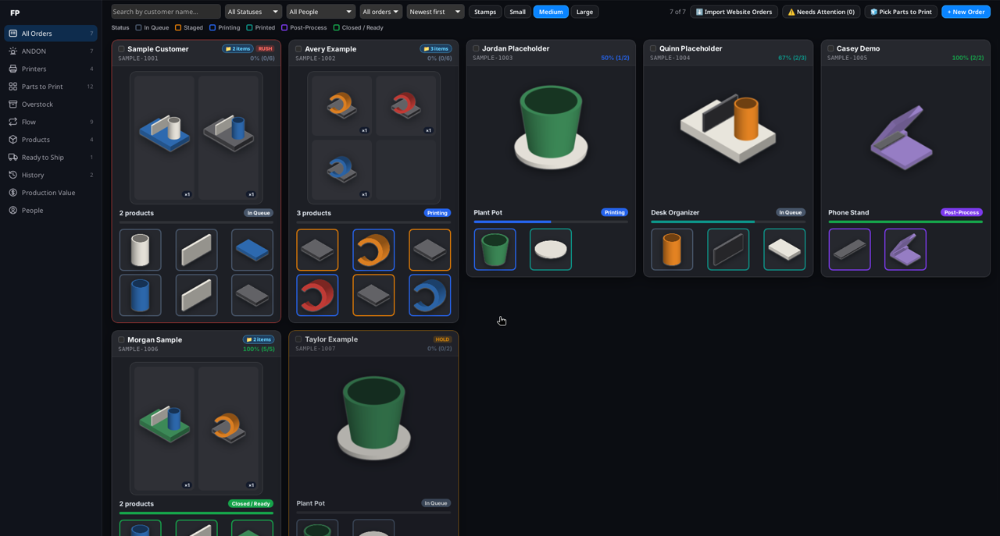
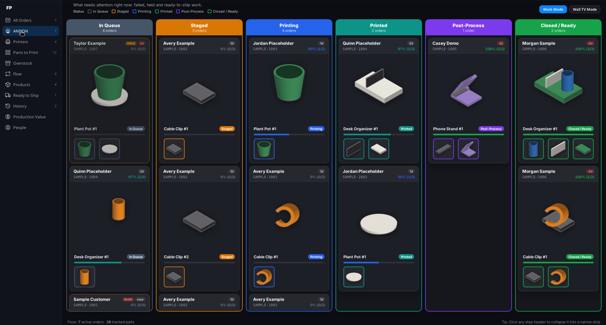
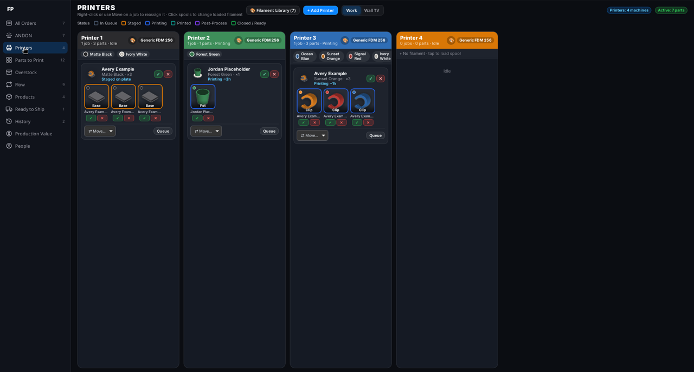

# FarmPrint

**A free production tracker for 3D print farms.** FarmPrint keeps track of every order, every part that still needs printing, and which printer is doing what, so nothing falls through the cracks between "order came in" and "box shipped."

> **Early release.** FarmPrint is at version 0.9 and still changing quickly. Back up anything important, and please [report bugs](https://github.com/blackburndesigned/farmprint-app/issues/new/choose) when you hit them.





## What it does

- **Orders.** Add orders by hand, or pull them in from your own web shop if you connect one. Each order shows a picture of the product the way the customer ordered it.
- **Parts to Print.** Breaks every order down into the individual parts and colors that still need printing.
- **Printers and plates.** Assign parts to your printers and send them straight to Bambu Studio. Parts land on a plate there, each one named with its order number, part and color.
- **ANDON board.** A big-screen view of what's printing, what's stuck and what needs attention.
- **Kitting cards.** Printable cards with product pictures and a checkbox parts list for packing each order.
- **Ready to Ship, History, Overstock and Production Value.** See what's ready to go out, what already went out, leftover parts you can reuse, and what your work is worth.
- **Works for any product.** Nothing is built around one shop's products. Import your own 3MF or STL files and set them up however you like.

Your data stays on your computer. FarmPrint doesn't need an account, and it doesn't send your orders anywhere unless you connect your own shop.

## Download

Grab the latest version from the [Releases page](https://github.com/blackburndesigned/farmprint-app/releases/latest).

| Computer | File to download |
|---|---|
| Mac with Apple chip (M1 or newer) | `FarmPrint_x.y.z_aarch64.dmg` |
| Mac with Intel chip | `FarmPrint_x.y.z_x64.dmg` |
| Windows 10 or 11 | `FarmPrint_x.y.z_x64-setup.exe` |
| Linux (Debian or Ubuntu) | `FarmPrint_x.y.z_amd64.deb` |
| Linux (other) | `FarmPrint_x.y.z_amd64.AppImage` |

Macs need macOS 11 Big Sur or newer. FarmPrint checks for updates on its own and asks before installing one.

## First launch: the security warnings are expected

FarmPrint isn't yet signed with a paid Apple or Microsoft developer certificate, so both systems warn you the first time. This is normal for free, independent apps.

**Mac**
1. Open the `.dmg` and drag FarmPrint into Applications.
2. Open FarmPrint. macOS will say it can't be opened. Click **Done**.
3. Open **System Settings**, go to **Privacy & Security**, scroll down, and click **Open Anyway** next to FarmPrint.
4. Open FarmPrint again and confirm. You only do this once.

If macOS says the app "is damaged," that's the same warning in a different form. Run this once in Terminal, then open it again:
```
xattr -cr /Applications/FarmPrint.app
```

**Windows**
1. Run the setup file.
2. If you see "Windows protected your PC," click **More info**, then **Run anyway**.

**Linux**
Install the `.deb` with your package manager, or make the AppImage executable (`chmod +x`) and run it.

## FAQ

**Is it really free?**
Yes. FarmPrint is free and open source under the GNU GPL v3. You can use it, change it and share it. If you share a changed version, you have to share its source code too.

**Do I need a web shop to use it?**
No. You can enter orders by hand. Pulling in web orders is optional and needs your own shop server, since FarmPrint doesn't come with one. A fresh copy starts with every connection blank and contacts nothing until you enter your own details.

**Where is my data stored?**
In a database file on your own computer. Nothing is uploaded unless you connect your own shop.

**Does it talk to my printers directly?**
Not yet. FarmPrint exports plates for your slicer, and you send them to the printer the way you already do.

**Which slicers work?**
For now, sending plates straight to the slicer only works with Bambu Studio.

**Can I try it with sample data first?**
Yes. On the welcome screen, click **Explore a sample shop first** (or **Load sample shop**) to try FarmPrint with made-up products, printers and orders. When you're ready to start for real, **Clear sample data** removes it.

**I found a bug or have an idea.**
Please use the [bug report and idea forms](https://github.com/blackburndesigned/farmprint-app/issues/new/choose). In the app you can also use **Help → Report a Bug**, which fills in your version for you. Please don't post customer names or addresses, and blur screenshots that show them.

**Who made this?**
One person who runs a small print farm and built FarmPrint to run his own shop.

## Build from source

You'll need [Rust](https://rustup.rs) 1.88 or newer and a current LTS release of [Node.js](https://nodejs.org). On Linux you'll also need the WebKitGTK and GTK development packages. Tauri's [prerequisites page](https://v2.tauri.app/start/prerequisites/) lists them for each distro.

```bash
# Build the interface
cd ui
npm ci
npm run build
cd ..

# Run the app from source
cargo run -p farmprint-app --features custom-protocol

# Or build installers for your system
cargo install tauri-cli --version "^2" --locked
cargo tauri build
```

To run the tests:

```bash
cargo test -p fp-core -p fp-mesh -p fp-sync
cd ui && npm test
```

The code is a Rust workspace. `crates/fp-core` holds the database and order logic, `crates/fp-mesh` reads 3MF and STL files and exports plates, `crates/fp-sync` handles the optional shop sync, `src-tauri` is the desktop app, and `ui` is the React interface.

## License

FarmPrint is licensed under the [GNU General Public License v3.0](LICENSE).
